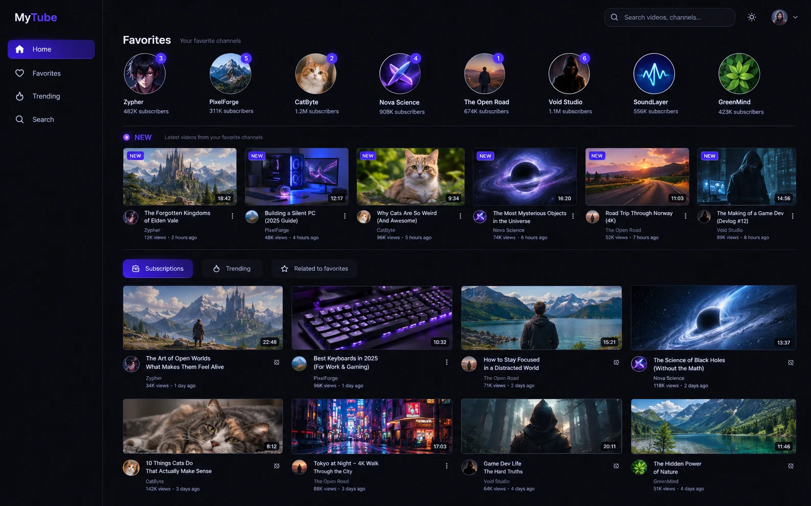
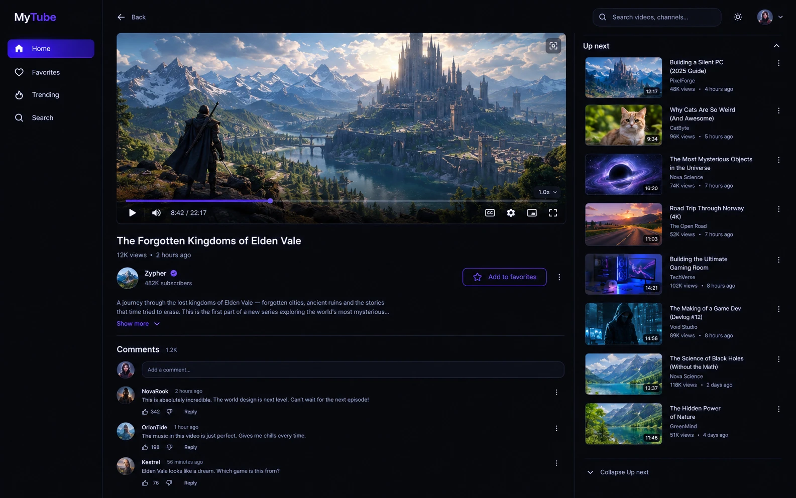
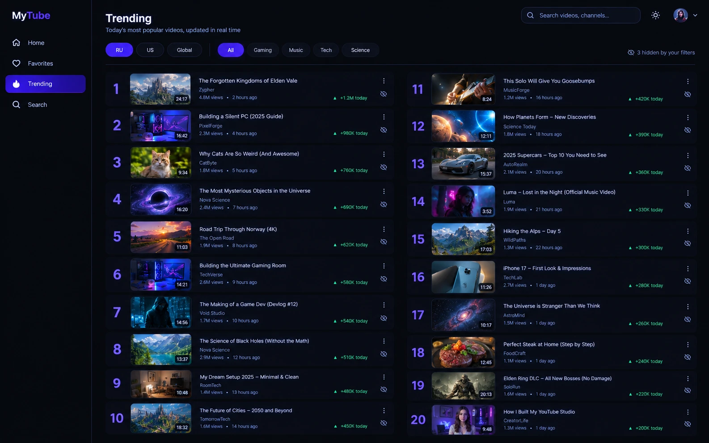
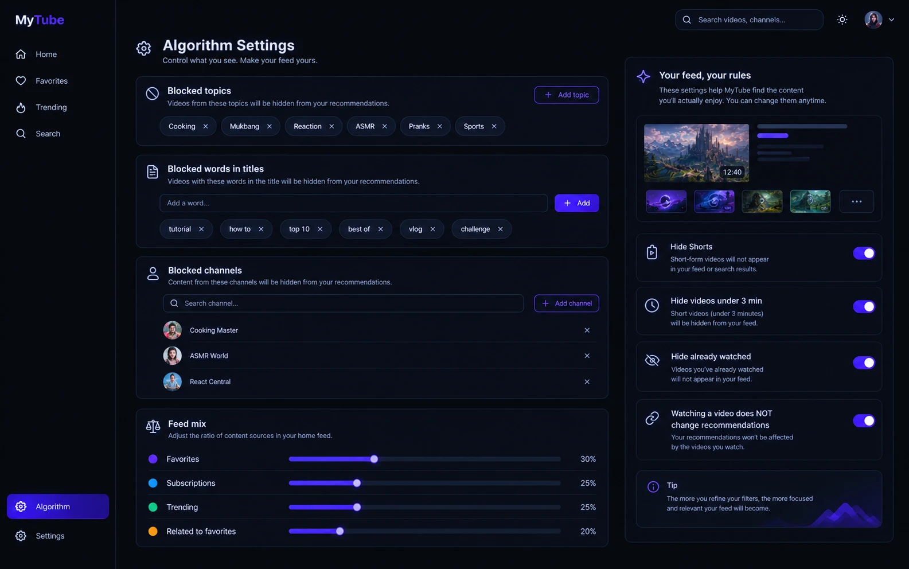

# MyTube

A personal desktop YouTube client with its own design and a feed algorithm **you** control.

> **Status:** early development. Windows installer: [Releases](https://github.com/Forecastych/mytube/releases/latest).



## Why

- Comments live **under** the video again, not in a sidebar.
- Four menu items: Home, Favorites, Trending, Search. No clutter.
- Trending is back, by region and category.
- Watching one cooking video does **not** turn your feed into cooking videos.
  Your feed follows only the rules you set: blocked topics, words and channels,
  plus how much comes from favorites, subscriptions, trending and related.
- New uploads from your favorite channels are always at the top.
- No Shorts, no mixes, no ads: MyTube plays streams with its own player, so
  YouTube's ads never load. Sponsor segments are skipped via
  [SponsorBlock](https://sponsor.ajay.app/).
- Lightweight: Tauri + Rust, no Electron, nothing running in the background.

| | |
|---|---|
|  |  |
|  | |

*Screens are design mockups; channel names are fictional.*

## How sign-in works

MyTube ships **without** any API keys. Every user connects their **own** free
Google Cloud project. That means:

- your quota (10,000 units/day) is yours alone, no one else drains it;
- your Google tokens never touch any server except Google's. They are stored
  in Windows Credential Manager on your machine;
- MyTube only asks for **read-only** access to your YouTube account.

Signing in is optional. Without it you can still add favorite channels by link
and get their new videos. Sign-in adds subscription import, Trending and comments.

## Google Cloud setup (≈10 minutes, free)

You do this once. No billing account or credit card is needed: ignore the
"Free Trial / $300 credit" banner.

1. **Create a project.** Open <https://console.cloud.google.com/>, then use the
   project picker at the top → **New project** → name it e.g. `MyTube`.
2. **Enable the API.** *APIs & Services → Library* → search
   **YouTube Data API v3** → **Enable**.
3. **Configure the consent screen.** *APIs & Services → OAuth consent screen*
   (opens *Google Auth Platform*) → **Get started**:
   - App name: `MyTube`, support email: your email;
   - Audience: **External**;
   - Contact email: your email → agree → **Create**.
4. **Add the scope.** *Data access → Add or remove scopes* → find
   `.../auth/youtube.readonly` → **Update** → **Save**.
5. **Add yourself as a test user.** *Audience → Test users → Add users* → your
   Google email.
6. **Create the OAuth client.** *Clients → Create client* → Application type
   **Desktop app** → name `MyTube desktop` → **Create**. Copy the **Client ID**
   and **Client secret** (or download the JSON).
7. **Paste them into MyTube** on first launch and click **Sign in with YouTube**.
   Your browser opens the Google sign-in page.

### Stay signed in for more than 7 days

While the app is in **Testing**, Google expires the sign-in after 7 days.
To avoid weekly re-login: *Audience → Publish app → Confirm*. You do **not**
need Google verification for personal use. On sign-in Google will show
"Google hasn't verified this app": click **Advanced → Go to MyTube (unsafe)**.
It is your own app talking to your own account.

Keep the client secret out of git, screenshots and issues.

## Build from source

Requirements (Windows): Rust (stable), Node.js 20+, Visual Studio Build Tools
with the C++ workload, WebView2 (preinstalled on Windows 10/11).
[yt-dlp](https://github.com/yt-dlp/yt-dlp) is bundled with the app for playback.
[mpv](https://mpv.io/) is optional ("Open in mpv" for 4K/HDR).

```bash
npm install
npm run tauri dev
```

*(Build steps will be finalized once the app skeleton lands.)*

## Your account stays safe

Only the official YouTube Data API ever sees your Google account, and only with
read-only access. Playback (yt-dlp) and related videos work **anonymously**:
MyTube never passes your cookies or tokens to them, and never writes anything
to your account.

## License

[GPL-3.0](LICENSE)

## Disclaimer

MyTube is an unofficial client, not affiliated with or endorsed by YouTube or
Google. It uses the official YouTube Data API under your own credentials.
